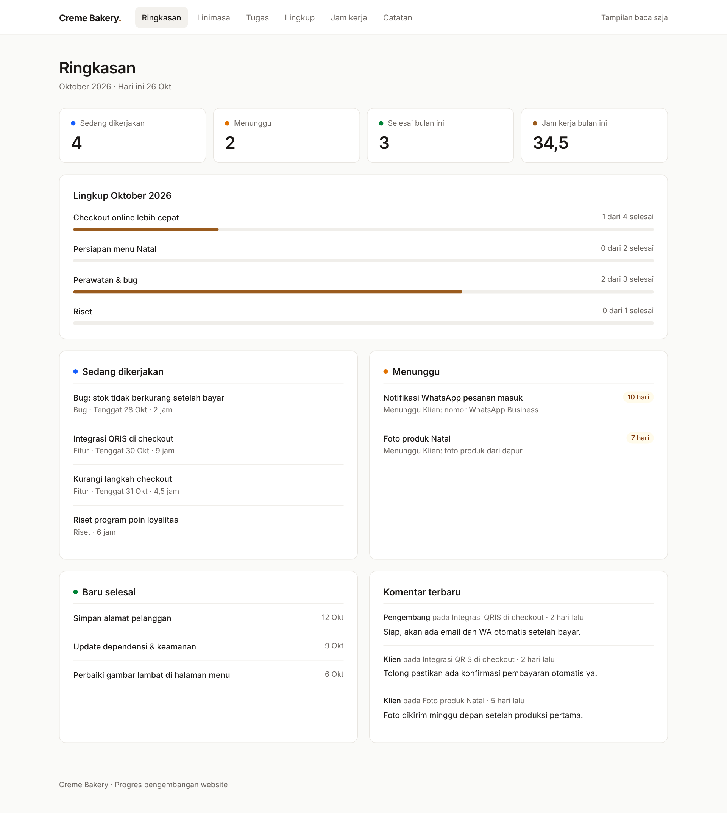
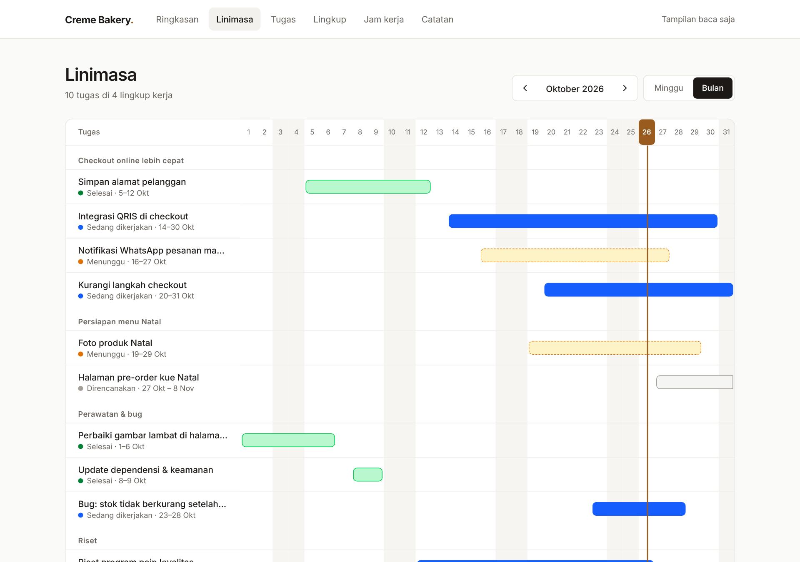
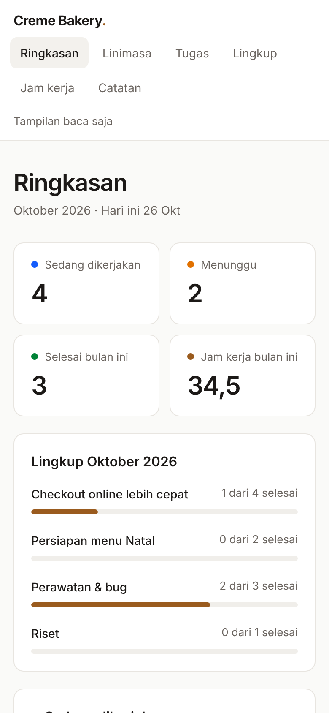
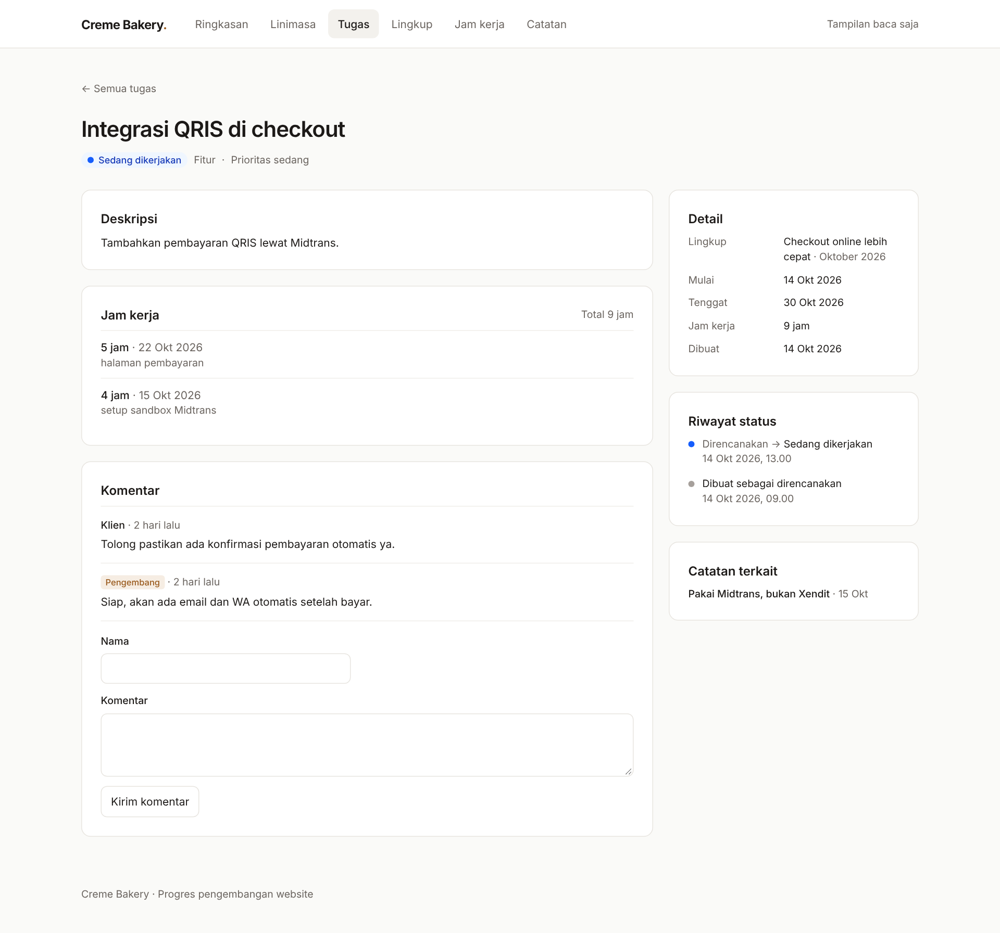

# Creme Bakery · Scope of Work

A lightweight progress site for a freelance engagement: instead of sending the client a Word report every week, the client opens one link and sees what's done, what's in progress, what's waiting on whom, and what's being researched, plus the hours behind it.

Built for the website work at Creme Bakery, a small bakery business. The interface is in Bahasa Indonesia.



## Why

Client reporting for part-time development work usually means a document assembled by hand at the end of the week. It's tedious to write, out of date the moment it's sent, and it hides the most useful signal: **what is blocked, and on whom**.

This site replaces that document with a live view of the same data the developer already works from. The client can check in whenever they want, leave comments on specific tasks, and see exactly how long something has been waiting for their input.

## Features

- **Overview (Ringkasan).** Counts of active, waiting and finished work, progress against this month's goals, and the latest client comments.
- **Timeline (Linimasa).** A Gantt-style view by month or week, grouped by monthly goal, with a marker for today. Blocked work is drawn with a dashed outline so it stands out.
- **Tasks.** Each task has a status (backlog, planned, in progress, waiting, done) and a type (feature, maintenance, bug, research).
  - *Waiting* tasks record who they're waiting on and why, and show how many days they've been blocked.
  - *Research* tasks capture the question being answered and the conclusion reached.
  - Every task can carry an optional note about its expected or observed business impact.
- **Monthly goals (Lingkup).** Work is grouped under goals agreed for each month. Weekly and daily views are filters over the same data, so nothing is entered twice.
- **Hours (Jam kerja).** Time logged per task, summarised by month, task, type and day.
- **Comments.** The client can comment on any task without an account. The developer's replies are labelled, and comments can be hidden or deleted.
- **Decision log (Catatan).** Dated notes recording what was decided and why, optionally linked to a task.
- **Screenshots.** Optional image uploads on tasks.
- **Status history.** Recorded automatically on every status change. This powers "waiting for 10 days" and the per-task history.

<table>
  <tr>
    <td></td>
    <td width="28%"></td>
  </tr>
</table>



## Access model

There are deliberately only two roles:

| Role | Can do |
|---|---|
| **Visitor** (the client, or anyone with the link) | Read everything, post comments |
| **Owner** (the developer) | Create, edit and delete everything; moderate comments |

The owner signs in with a single username and password held in environment variables. There is no user table, because there is exactly one editor. A successful login sets a signed, HTTP-only cookie, and every write operation re-checks that cookie on the server.

Public comments are protected by a hidden honeypot field and a per-visitor rate limit. Visitor IP addresses are stored only as salted hashes. Pages are marked `noindex`, so the site stays out of search engines.

## Tech stack

| | |
|---|---|
| Framework | [Next.js 16](https://nextjs.org) (App Router, Server Components, Server Actions) |
| Language | TypeScript |
| Styling | [Tailwind CSS 4](https://tailwindcss.com), Inter |
| Database | PostgreSQL on [Supabase](https://supabase.com) |
| ORM / migrations | [Drizzle ORM](https://orm.drizzle.team) |
| Validation | [Zod](https://zod.dev) |
| File storage | Supabase Storage (optional) |
| Hosting | [Vercel](https://vercel.com) |

There is no separate API layer. Pages read from the database in Server Components, and every change goes through a Server Action in `src/app/actions.ts`.

## Data model

```
monthly_scopes ──< tasks ──< time_logs
                     │──< status_history
                     │──< comments
                     │──< attachments
                     └──< notes  (optional link)
```

| Table | Purpose |
|---|---|
| `monthly_scopes` | Goals agreed for a given month |
| `tasks` | The unit of work: status, type, dates, waiting info, research fields, impact note |
| `status_history` | Every status change, written automatically |
| `time_logs` | Hours per task per day |
| `comments` | Visitor and owner comments, with a hidden flag for moderation |
| `attachments` | Uploaded screenshots |
| `notes` | Decision log |

The schema lives in [`src/db/schema.ts`](src/db/schema.ts), and the generated SQL migrations are in [`drizzle/`](drizzle).

## Project structure

```
src/
  app/              routes (one folder per page) and actions.ts (all writes)
  components/       header, forms and small UI primitives
  db/               schema and database client
  lib/              auth, date helpers (WIB timezone), labels, queries, storage
drizzle/            SQL migrations
scripts/migrate.ts  applies migrations
```

## Running it yourself

Requires Node.js 20.9+ and a PostgreSQL database. A free Supabase project works well; use its **transaction pooler** connection string.

```bash
npm install
cp .env.example .env.local   # then fill in the values below
npm run db:migrate           # creates the tables
npm run dev                  # http://localhost:3000
```

Sign in at `/masuk`. The login page is intentionally not linked from the menu.

| Variable | Required | Description |
|---|---|---|
| `DATABASE_URL` | yes | Postgres connection string |
| `OWNER_USERNAME` | yes | Owner login name |
| `OWNER_PASSWORD` | yes | Owner password |
| `SESSION_SECRET` | yes | Random string of 32+ characters used to sign the login cookie. Changing it signs out every session |
| `SUPABASE_URL` | no | Supabase project URL, for screenshot uploads |
| `SUPABASE_SERVICE_ROLE_KEY` | no | Supabase secret key, for screenshot uploads |
| `SUPABASE_BUCKET` | no | Name of a **public** storage bucket (default `lampiran`) |

Leave the three `SUPABASE_*` variables empty to turn off uploads.

**Deploying:** import the repository in Vercel and add the same environment variables. If the database is in Singapore, set the Vercel function region to Singapore (`sin1`) as well. Migrations are not run during the build; apply them with `npm run db:migrate`.

**Changing the schema:** edit `src/db/schema.ts`, then run `npm run db:generate` and `npm run db:migrate`.

## Scripts

| Command | |
|---|---|
| `npm run dev` | Development server |
| `npm run build` / `npm start` | Production build and server |
| `npm run typecheck` | TypeScript check |
| `npm run db:generate` | Generate a migration from schema changes |
| `npm run db:migrate` | Apply pending migrations |

---

Screenshots show sample data.
